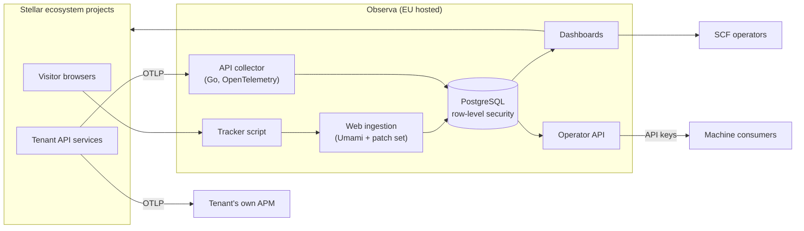

# Observa

Privacy-first web and API analytics for Stellar ecosystem projects.

> **Status: early development.** Observa is being built in response to the Stellar Community Fund (SCF) RFP "Web and API Analytics for Stellar Ecosystem Projects". Nothing is live yet. Everything described here is planned or in development, and details may change.

## The problem

SCF currently relies on usage numbers that projects report themselves. That causes three problems:

- **Numbers are hard to trust.** Each project measures traffic differently, and some can't measure it at all.
- **Reviewers carry the overhead.** People reviewing SCF submissions have to interpret screenshots, spreadsheets and claims that can't be compared.
- **There is no common way to see which projects are actually used.** Without independent data, funding decisions are harder to make well.

## What Observa does

Observa is a multi-tenant analytics service that SCF can run as a free shared service for projects building on Stellar. Every project (tenant) sends usage data to the same platform, measured the same way.

### Web analytics

Observa is based on [Umami](https://umami.is) v3 (MIT). Observa tracks a pinned upstream version and keeps its own changes as a small, documented patch set.

- Page views, unique visitors, referrers, session duration and bounce rate
- Country-level geography and device/browser breakdown
- Optional custom events
- Optional automatic Stellar Wallets Kit events (wallet connect and sign actions; wallet addresses are never recorded)
- Bot filtering, plus checks that the data came from a real browser that ran JavaScript
- A version-pinned tracker script with Subresource Integrity hashes and signed releases

### API analytics

The API analytics path is a Go service built on the OpenTelemetry Collector.

- Tenants send standard OTLP (gRPC on port 4317, HTTP on port 4318) to their own monitoring tool and to Observa at the same time (dual export).
- Observa keeps only the data needed for counters and histograms. It drops traces, spans and detailed logs after deriving request metrics from them.
- Dashboards show request volume, status-code distribution and p50/p95 latency for each service and route.
- A built-in default rule set normalises paths. For example, `/accounts/GABC...XYZ` becomes `/accounts/{address}`, so one route doesn't turn into thousands of separate paths. Tenants who want more control can set `http.route` in their own middleware.

## Who sees what

| Role | Access |
|------|--------|
| Tenant (a Stellar project) | Only its own web and API analytics |
| SCF operator | A global view across all tenants, to compare projects |
| API key consumer (machine client) | Read access via API keys that SCF operators create and revoke |

Tenant data is kept apart at the database level using PostgreSQL row-level security.

Any Stellar project can enrol itself. Verification is planned through the project's `stellar.toml` (SEP-1) and its Stellar account or Soroban contract IDs. Sign-in is planned through Stellar wallets (SEP-10 / SEP-45).

## Privacy principles

- No cookies, and no client-side consent banner needed for GDPR compliance
- IP addresses are truncated before geolocation and never stored raw
- Unique visitors are counted with a salted hash that rotates daily, so visitors can't be followed across days
- Data is hosted in the EU (proposed: Hetzner, Germany)
- The design goal is to store no personal data that would be subject to erasure requests. If any is stored, tenants get an erasure workflow.

See [docs/architecture.md](docs/architecture.md#privacy-and-gdpr-approach) for details.

## System overview



## Planned monorepo structure

All code, infrastructure-as-code and documentation live in this repository.

```text
observa/
├── apps/
│   ├── web/             # Umami v3 (pinned) + Observa patch set: multi-tenant dashboards, operator view
│   └── collector/       # Go OpenTelemetry-based API telemetry collector
├── packages/
│   ├── tracker/         # Version-pinned browser tracking script
│   └── path-normalizer/ # Shared default path normalisation rules + tests
├── infra/               # OpenTofu modules, container configs, environments
├── ops/
│   ├── runbooks/        # Operator runbooks (incidents, backups, upgrades, handover)
│   └── monitoring/      # Prometheus/Grafana dashboards and alert rules
├── docs/                # Architecture, privacy, onboarding, security docs
└── tests/               # End-to-end and integration tests
```

## Roadmap (draft)

This roadmap is a draft. It follows the structure of the RFP and may change.

1. **Core platform and web analytics.** Multi-tenant data model with row-level security, the Umami-based web analytics with the Observa patch set, the tracker script, self-service enrolment, and EU infrastructure as code.
2. **API analytics and dashboards.** The OpenTelemetry-based collector, path normalisation, rollups, API dashboards (volume, status codes, p50/p95 latency), the SCF operator global view, and API keys for machine consumers.
3. **Hardening, live adoption and handover readiness.** Bot and inflation defences, supply-chain controls, monitoring and alerting, and runbooks. Live adoption by at least 3 SCF projects on web analytics and at least 1 on API analytics.
4. **Hosting and handover.** 12 months of hosting and support after the final development tranche, then handover to a community-appointed operator.

## Contributing

The project is at an early stage. Issues and discussion are welcome. Contribution guidelines will be added as the codebase takes shape. All contributions are accepted under the MIT licence.

## Security

Please do not report security issues in public issues. Contact: `security@<to be confirmed>` (placeholder). A full security policy (`SECURITY.md`) is planned.

## Licence

[MIT](LICENSE). Copyright (c) Observa contributors.

Observa is built in response to an SCF RFP. It is not affiliated with or endorsed by the Stellar Development Foundation or the Stellar Community Fund.
