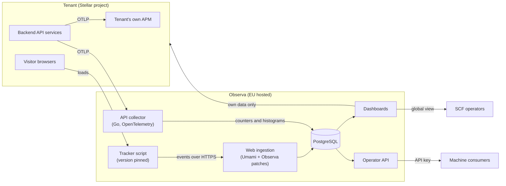
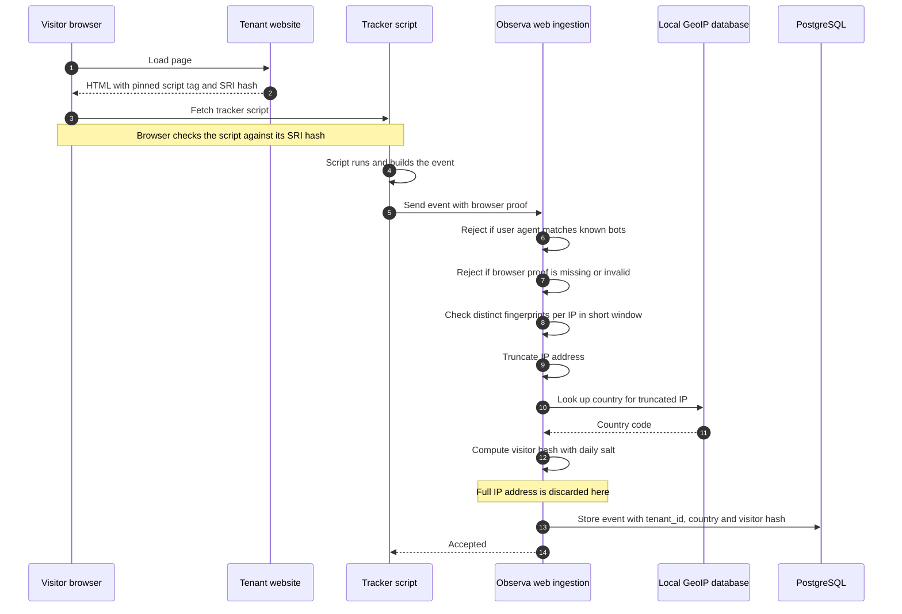
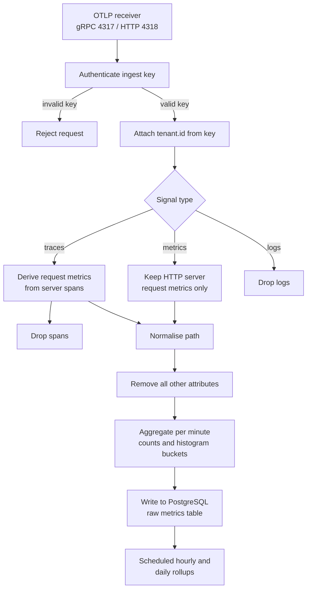
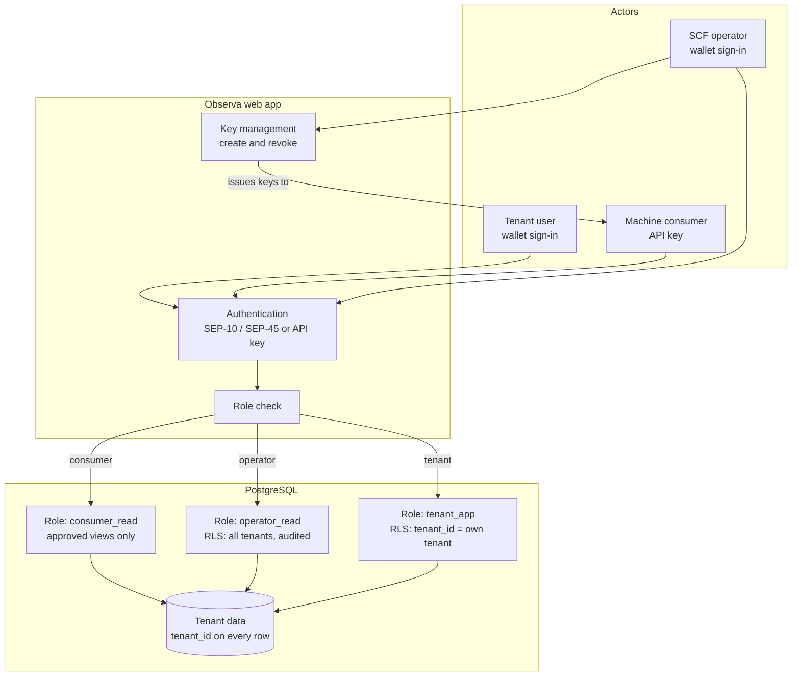
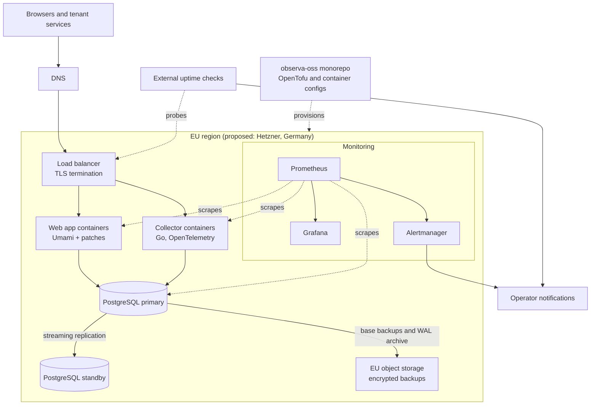

# Observa architecture

> **Status: draft.** Observa is in early development and nothing described here is live yet. This document describes the planned design. Where something is not yet decided, it is listed under [Open decisions](#open-decisions).

This document explains how Observa is planned to work. It is written for SCF reviewers and does not assume specialist knowledge of analytics or observability tooling. Technical terms are explained when they first appear.

## Contents

- [Summary](#summary)
- [System overview](#system-overview)
- [Components](#components)
- [Web analytics: how a page view is recorded](#web-analytics-how-a-page-view-is-recorded)
- [API analytics: the telemetry pipeline](#api-analytics-the-telemetry-pipeline)
- [Data model overview](#data-model-overview)
- [Multi-tenancy and isolation](#multi-tenancy-and-isolation)
- [Enrolment and Stellar verification](#enrolment-and-stellar-verification)
- [Bot and inflation mitigation](#bot-and-inflation-mitigation)
- [Tracker versioning and supply-chain security](#tracker-versioning-and-supply-chain-security)
- [Privacy and GDPR approach](#privacy-and-gdpr-approach)
- [Scalability](#scalability)
- [Reliability and availability](#reliability-and-availability)
- [Deployment and infrastructure](#deployment-and-infrastructure)
- [Observability](#observability)
- [Decentralisation](#decentralisation)
- [Handover plan](#handover-plan)
- [Open decisions](#open-decisions)

## Summary

Observa is a shared analytics service that SCF can run for projects building on Stellar. It has two data paths that share one database:

1. **Web analytics.** A small script on a project's website reports page views and similar events. This path is based on Umami v3, an open-source (MIT) web analytics tool.
2. **API analytics.** A project's backend services send standard OpenTelemetry data to Observa. A Go service built on the OpenTelemetry Collector turns that data into request counts and latency figures and throws away everything else.

Both paths write to PostgreSQL. Every row belongs to a tenant (a project), and the database itself enforces that tenants can only read their own rows. SCF operators get a global view across all tenants.

## System overview

## Components

| Component | Location in repo | What it does |
|-----------|------------------|--------------|
| Web app | `apps/web/` | Umami v3 at a pinned upstream version, plus a small Observa patch set. Receives web events, serves tenant dashboards, the SCF operator global view, enrolment, and the operator API. |
| API collector | `apps/collector/` | A custom build of the OpenTelemetry Collector written in Go. Receives OTLP, works out which tenant the data belongs to, derives request metrics, normalises paths, aggregates, and writes to PostgreSQL. |
| Tracker | `packages/tracker/` | The browser script that tenants add to their sites. Released as numbered versions with integrity hashes and signatures. |
| Path normaliser | `packages/path-normalizer/` | The default rules that turn raw URL paths into route templates, with a shared test suite. Used by the collector. |
| Infrastructure | `infra/` | OpenTofu code and container configuration that can rebuild the whole environment from scratch. |
| Operations | `ops/` | Runbooks, plus Prometheus and Grafana configuration for monitoring Observa itself. |

### How Observa uses Umami

Umami already provides most of what the web analytics path needs: a tracker, an ingestion endpoint, dashboards, and the core metrics (page views, visitors, referrers, sessions, bounce rate, geography, devices and browsers). Umami v3 supports PostgreSQL only, which matches Observa's single-database design.

Observa does not fork Umami into a separate long-lived codebase. It pins a specific upstream release and applies a small set of documented patches on top. Each patch has a stated purpose, so that upgrading to a new Umami release means re-applying and re-testing a short, known list of changes. Planned patch areas:

- Tenant model and row-level security (see [Multi-tenancy and isolation](#multi-tenancy-and-isolation))
- SCF operator global view and the operator API
- Stellar wallet sign-in and enrolment
- IP truncation before geolocation, and daily salt rotation for visitor hashing
- Bot and inflation checks beyond Umami's built-in filtering
- Optional Stellar Wallets Kit events in the tracker

The goal is to keep the patch set small. Features that can live outside Umami (for example, the operator API) may be built as separate modules in `apps/web/` instead of as patches.

### How the API collector is built

The OpenTelemetry Collector is a widely used open-source program for receiving, processing and exporting telemetry. It is designed to be extended: you can build your own distribution containing only the components you need, plus your own components written in Go.

Observa's collector is planned as such a custom distribution:

- **Receiver:** the standard OTLP receiver (gRPC on 4317, HTTP on 4318)
- **Authentication:** an extension that checks a per-tenant ingest key sent with each request
- **Span-to-metrics step:** derives request counts and duration histograms from server spans, in the same way as the upstream `spanmetrics` connector
- **Observa processor:** sets the tenant, normalises paths, removes unneeded attributes and drops everything else
- **PostgreSQL exporter:** writes aggregated data points to the database

## Web analytics: how a page view is recorded

"Geolocation" here means looking up the country for an IP address in a local database file. No external service is called.

What is stored for each event: tenant and website identifiers, a timestamp, the page path (query strings removed by default), referrer, country, device type, browser and operating system, the daily visitor hash, and the event name and properties if it is a custom event. Umami also collects screen size, browser language and page titles by default, and resolves region and city. Observa stores country only and treats the other fields as open privacy decisions. No cookies are set, and nothing is stored in the visitor's browser. The full list is in [privacy.md](privacy.md#data-collected-web-analytics).

### Optional Stellar Wallets Kit events

Tenants that use Stellar Wallets Kit will be able to turn on automatic events such as "wallet connected" and "transaction signed", along with the wallet type. Wallet addresses, transaction contents and signatures are never sent. The tracker sends only the event name and a small fixed set of non-identifying properties.

## API analytics: the telemetry pipeline

### What tenants send

Tenants instrument their services with OpenTelemetry, as many teams already do for their own monitoring. They add Observa as a second destination in their exporter or collector configuration ("dual export"), so the same data goes to their own APM tool and to Observa. Observa doesn't replace the tenant's monitoring and doesn't need its own SDK.

Observa needs these fields:

| Field | Standard OpenTelemetry name | Purpose |
|-------|-----------------------------|---------|
| Tenant | Set by Observa from the ingest key (`tenant.id`) | Which project the data belongs to |
| Service | `service.name` (resource attribute) | Which of the tenant's services |
| Route | `http.route` | Normalised path, such as `/accounts/{address}` |
| Status | `http.response.status_code` | Status-code distribution |
| Latency | `http.server.request.duration` histogram, or server span duration | p50 and p95 latency |

The HTTP method (`http.request.method`) is also planned as a dimension, because the same route can serve different operations.

Tenants can send either metrics (the `http.server.request.duration` histogram) or traces. If they send traces, Observa derives the same metrics from server spans and then drops the spans.

The tenant is always set from the authenticated ingest key, never from attributes in the data. One tenant can't write data under another tenant's name.

### Pipeline

### Path normalisation

Raw URL paths often contain identifiers, such as `/accounts/GAB.../payments`. If every distinct path were counted separately, a dashboard would show thousands of meaningless rows, and storage would grow without limit. Path normalisation replaces identifiers with placeholders.

The rules are:

1. If the tenant already sets `http.route` (most web frameworks can do this), Observa uses it as-is, apart from removing trailing slashes.
2. Otherwise, Observa applies a fixed default rule set, segment by segment, to the raw path.

Default rules (proposed placeholder names):

| Pattern | Example input | Output |
|---------|---------------|--------|
| Stellar account address (`G...`, 56 characters) | `/accounts/GAB...` | `/accounts/{address}` |
| Soroban contract address (`C...`, 56 characters) | `/contracts/CDL...` | `/contracts/{address}` |
| Muxed account address (`M...`, 69 characters) | `/accounts/MAQ...` | `/accounts/{address}` |
| UUID | `/orders/3f2c...` | `/orders/{uuid}` |
| Hex or crypto hash (such as a 64-character transaction hash) | `/tx/a1b2...` | `/tx/{hash}` |
| Numeric ID | `/ledgers/51234567` | `/ledgers/{id}` |
| Trailing slash | `/assets/` | `/assets` |

There will be no user interface for custom rules. Tenants that need finer control set `http.route` in their own middleware. The rules and their tests live in `packages/path-normalizer/`.

As a further safeguard, a limit on the number of distinct routes per service is planned. Routes beyond the limit would be grouped under a single overflow value. The exact limit is an open decision.

### Percentiles

p50 and p95 latency are calculated from histogram buckets, not from individual requests. Observa stores bucket counts at every level (raw, hourly and daily), so it can recalculate percentiles for any time range by adding buckets together. The result is an estimate whose precision depends on the bucket boundaries. This is the normal trade-off for histogram-based latency metrics.

## Data model overview

Every table that holds tenant data has a `tenant_id` column. Table names below are proposed and may change during implementation.

| Area | Table (proposed) | Contents |
|------|------------------|----------|
| Tenants | `tenant` | Name, domain, status (active, suspended, removed), verification state |
| | `tenant_stellar_id` | Stellar account and Soroban contract IDs linked to the tenant, with verification time |
| | `tenant_member` | Stellar public keys allowed to sign in for the tenant, and their role |
| Web (Umami) | `website`, `session`, `website_event`, `event_data` and related Umami tables | Umami's existing schema, extended with `tenant_id` |
| API ingest | `ingest_key` | Hashed per-tenant ingest keys |
| API metrics | `api_metric_raw` | Per-minute counts and histogram buckets by tenant, service, route, method and status code |
| | `api_metric_hourly`, `api_metric_daily` | Rollups of the same dimensions |
| Access | `consumer_api_key` | Hashed API keys for machine consumers, with scope, creator and revocation time |
| | `audit_log` | Operator actions such as key creation, revocation and tenant removal |

Note that even the "raw" API metrics table holds per-minute aggregates, not individual requests.

### Retention

| Data | Retention |
|------|-----------|
| Raw API metrics (per minute) | Short troubleshooting window. Proposed 30 days; see open decisions. |
| Hourly and daily rollups | At least 24 months |
| Web events | To be decided: either kept at full detail for 24 months, as Umami does natively, or rolled up after a shorter window |

Retention is enforced by scheduled jobs. Time-based table partitioning is planned so that old data can be removed cheaply by dropping whole partitions.

## Multi-tenancy and isolation

A "tenant" is one Stellar project. Isolation is enforced in the database, not just in application code, so a bug in a dashboard query can't leak another tenant's data.

**Row-level security (RLS)** is a PostgreSQL feature that attaches a rule to a table, such as "only return rows whose `tenant_id` matches the current session's tenant". The database applies the rule to every query automatically.

The plan:

- Each request sets the current tenant in the database session (for example `SET LOCAL app.tenant_id = ...` inside a transaction) based on the signed-in user.
- RLS policies on every tenant table compare `tenant_id` with that setting.
- The application connects as a database role that can't bypass RLS.
- The SCF operator view uses a separate, audited role whose policies allow reading across tenants.
- Machine consumers get read-only access to approved views through the operator API. They never get direct database access.

Umami uses the Prisma database library. Using RLS with Prisma means setting the tenant at the start of every transaction. Doing this reliably, while keeping the patch set small, is one of the main implementation risks and will be covered by dedicated isolation tests in `tests/`.

## Enrolment and Stellar verification

Enrolment is self-service for any Stellar project. The planned flow:

1. **Sign in with a Stellar wallet.** Observa uses SEP-10 (Stellar Web Authentication) for classic Stellar accounts and SEP-45 (Web Authentication for Contract Accounts) for Soroban contract accounts such as smart wallets. The user signs a challenge, which proves they control the account. No password or email address is needed. To support this, Observa publishes its own `stellar.toml` with the required web authentication fields.
2. **Claim a domain.** The project enters its domain. Observa fetches `https://<domain>/.well-known/stellar.toml` (SEP-1).
3. **Prove domain control.** The project's `stellar.toml` must list the Stellar account used to sign in (for example in its `ACCOUNTS` list). Only someone who controls the domain can edit that file, and the signed challenge from step 1 shows that the same person controls the account, so together they link the person, the account and the domain. The exact `stellar.toml` fields to use are an open decision.
4. **List on-chain identifiers.** The project lists its Stellar account IDs and Soroban contract IDs. Observa checks through Stellar RPC or Horizon that they exist on the network.
5. **Start tracking.** The project gets a tracker snippet for its websites and an ingest key for its API services.

Operators can remove projects that are not part of the Stellar ecosystem. The design keeps enrolment behind a setting, so the system can later switch to approval-required enrolment without code changes.

## Bot and inflation mitigation

Independent usage data is only useful if it is hard to inflate. Observa plans several layers. None is perfect alone.

1. **Known bot filtering.** Umami already rejects requests whose user agent matches known bots and crawlers, using the `isbot` library. Observa keeps this.
2. **Proof that JavaScript ran.** Sending fake events with a simple HTTP script is easy. Observa plans to require proof that the tracker actually ran in a browser, so that pure server-side posts are rejected. For example, the tracker could fetch a short-lived signed token and include it with each event. The exact mechanism is an open decision. This raises the cost of fake traffic, but it can't stop a determined attacker running real headless browsers.
3. **Many fingerprints from one IP.** A fingerprint here means the combination of user agent and other request properties used to tell visitors apart. When one IP address produces an unusually large number of distinct fingerprints in a short time, its events are treated as suspicious. This check needs the full IP for a few minutes, so it runs in memory using a keyed hash of the IP, and the counters expire quickly. The full IP is never written to disk.
4. **API path.** Ingest keys are per tenant and can be rotated or revoked. Because the tenant is set from the key, a tenant can only inflate its own API numbers, and operators can spot sudden unexplained jumps in the global view.

Whether suspicious events are dropped outright or stored with a flag (so operators can see how much was filtered) is an open decision.

## Tracker versioning and supply-chain security

### Tracker script

The tracker runs on tenant websites, so a compromised tracker would affect every tenant. The plan:

- **Version pinned.** Each release is served from a versioned URL that never changes. Observa doesn't push automatic updates. Tenants choose when to upgrade by changing the version in their script tag.
- **Subresource Integrity (SRI).** Each release has a published hash. Tenants include it in the `integrity` attribute of the script tag, and the browser refuses to run the script if its contents don't match.
- **Signed releases.** Release files are signed, so anyone can check that a file came from the Observa project.
- **Neutral names.** The script path and event endpoint use neutral names that are not on popular ad-blocker filter lists. Umami already supports configuring these names. Filter lists change over time, so this can't be guaranteed.
- **Self-hosting option.** Because the script is static and versioned, tenants can also host it themselves.

### Build and dependency supply chain

- **Pinned dependencies and lockfiles** for every package, plus pinned container base images by digest
- **Automated dependency updates** that open pull requests for a human to review, never merged automatically
- **SBOMs** (software bills of materials, which list every component in a build) generated for each release and container image
- **Signed build artifacts**, using Sigstore/cosign for container images and release files
- **Reproducible builds where practical.** Go binaries and the tracker script are good candidates. The Node.js-based Umami build may not be fully reproducible.
- **Upstream tracking.** Umami and OpenTelemetry Collector upgrades are deliberate, reviewed changes to a pinned version.

## Privacy and GDPR approach

Observa aims to give useful aggregate numbers without collecting personal data about visitors.

### Data residency

All data is planned to be stored and processed in the EU. The proposed hosting provider is Hetzner, in Germany. Backups are also planned to stay in the EU.

### No cookies and no device storage

The tracker sets no cookies and writes nothing to local storage or similar browser storage. Without device storage or personal data, the design aims for GDPR compliance without a client-side consent banner. The tracker does read some browser properties (such as screen size and language), which may fall under ePrivacy rules depending on interpretation; this is part of the planned legal review (see [privacy.md](privacy.md#lawful-basis-and-consent)). Tenants remain responsible for their own legal assessment.

### IP address handling

- IP addresses are truncated before any other use. For IPv4 the last octet is removed (`203.0.113.45` becomes `203.0.113.0`). For IPv6 the address is cut to its first 48 bits.
- Country lookup uses the truncated address and a local GeoIP database.
- Raw IP addresses are never written to the database or to logs.
- The only exception is the in-memory, short-lived abuse check described under [Bot and inflation mitigation](#bot-and-inflation-mitigation). It holds a keyed hash, not the IP itself, and nothing is persisted.

### Unique visitors

To count unique visitors without cookies, Observa computes a hash from the website, the truncated IP, the user agent and a secret salt. The salt changes every day and old salts are deleted. This means:

- The same visitor counts once per day per website
- The same visitor can't be linked across days, because the hash changes
- The hash can't be reversed to an IP address once the salt is deleted

Umami already uses a salted hash for sessions. Observa's patch set changes the salt to rotate daily and uses the truncated IP.

As a result, a "unique visitor" count over a week is a sum of daily counts, and a visitor who returns on several days is counted once per day.

### Erasure

The design goal is that visitor analytics data contains no personal data, so there is nothing to erase in response to an individual's request. If any data is found to be personal, or a tenant chooses to store personal data in custom event properties against the documentation, Observa will provide a tenant-triggered erasure workflow. This would let a tenant delete data for a website, a service, a time range, or matching custom event properties.

Tenant account data is separate from visitor data. This includes the Stellar public keys used to sign in and the project's domain. A tenant can delete its account and all associated analytics data.

### API analytics

The API path keeps only the service name, normalised route, method, status code and latency buckets. Request bodies, headers, client IPs, user IDs and all other span and log content are dropped before storage. Path normalisation also removes Stellar addresses and other identifiers from paths.

## Scalability

The design target is about 1,000,000 API requests per day across all tenants. On average that is about 12 requests per second. Traffic is uneven, so the design allows for peaks many times higher.

What reaches Observa depends on how tenants send data:

- **Metrics:** each tenant service sends one batch of histogram data points per export interval (often 60 seconds), whatever its traffic. Load on Observa depends on the number of services and routes, not the number of requests.
- **Traces:** Observa receives one server span per request, so roughly 1,000,000 spans per day at the target load. These are turned into metrics in memory and dropped.

In both cases, what is written to PostgreSQL is per-minute aggregates. Database writes therefore grow with the number of distinct tenant, service, route, method and status combinations, not with request volume. This is why path normalisation and the route limit matter.

Planned measures:

- The collector is stateless apart from short in-memory aggregation windows, so more instances can be added behind a load balancer
- Batched database writes
- Time-partitioned tables, so queries and deletions only touch the partitions they need
- Dashboards read from hourly and daily rollups for longer time ranges
- Load tests against the 1,000,000 requests/day target (with peak multipliers) in phase 3, with results published in this repository

No benchmark results exist yet. This document will be updated when they do.

## Reliability and availability

Observa is an analytics service, not part of any tenant's critical path. If Observa is unavailable, tenant websites and APIs keep working. The tracker sends events asynchronously, and OpenTelemetry exporters drop or retry data without blocking the application. Dual export means the tenant's own monitoring is unaffected.

Planned measures:

- Health checks and automatic container restarts
- A PostgreSQL standby replica, with documented promotion steps
- Regular automated backups, including continuous archiving of the database write-ahead log for point-in-time recovery, stored in EU object storage
- Regular restore tests, documented in the runbooks
- Zero-downtime deployments for stateless services where practical
- Runbooks in `ops/runbooks/` for incidents, backups, upgrades and recovery

A formal availability target has not been set. It is listed as an open decision.

## Deployment and infrastructure

All infrastructure is defined in this repository using OpenTofu (an open-source infrastructure-as-code tool compatible with Terraform) and container definitions. An operator with a hosting account and the required secrets should be able to rebuild the whole environment from `infra/`.

Hetzner does not offer a managed PostgreSQL service, so PostgreSQL is planned to run as a self-managed service with the backup and replication setup above. Which container orchestration to use (for example Docker Compose on virtual machines, or a small Kubernetes distribution) is an open decision.

## Observability

Observability here means monitoring Observa itself, not tenant data.

- **Metrics:** Prometheus collects metrics from the web app, the collector (the OpenTelemetry Collector exposes its own internal metrics), PostgreSQL and the host machines.
- **Dashboards:** Grafana dashboards for ingestion rates, rejected and filtered events, write latency, database health, disk usage and backup status. Dashboard definitions live in `ops/monitoring/`.
- **Alerts:** alert rules for service down, ingestion stopped, error rates, replication lag, failed backups and low disk space, also in `ops/monitoring/`.
- **External uptime checks:** an independent service outside Observa's hosting probes the public endpoints, so an outage is detected even if the whole hosting environment is down. The provider is an open decision.
- **Logs:** operational logs avoid personal data. They never contain raw IPs, ingest keys or request bodies.

## Decentralisation

Observa is a centrally operated service. This section explains why that fits this RFP, and how the design avoids lock-in to any single operator.

**Why central operation fits.** The RFP asks for independent, trusted usage data that SCF can compare across projects. That needs one consistent measurement method, applied the same way to every project and run by a party other than the projects themselves. A decentralised design, where each project runs its own analytics and reports results, would bring back the self-reporting problem Observa is meant to solve. Analytics also involves high-volume writes and aggregate queries that suit a conventional database better than a blockchain. Writing analytics data on-chain would also make privacy guarantees such as deletion and daily unlinkability much harder.

**How the design limits the downsides:**

- **Open source.** All code is MIT licensed and lives in one public repository. Anyone can audit how numbers are calculated.
- **Rebuildable.** Infrastructure-as-code and runbooks mean any competent operator can run their own instance or take over the shared one.
- **Forkable.** If the community disagrees with how the service is run, it can fork the repository and run an alternative.
- **Standard inputs.** Tenants use standard OTLP and a small tracker script, so they aren't locked into Observa-specific SDKs.
- **Planned handover.** Operation is planned to move to a community-appointed operator after the support period (see below).
- **Stellar-native identity.** Sign-in and verification rely on Stellar standards (SEP-1, SEP-10, SEP-45) and on-chain data, not on a proprietary identity provider.

## Handover plan

Observa will be hosted and supported for 12 months after the final development tranche, then handed over to a community-appointed operator. The plan:

1. **Repository.** The `observa-oss` GitHub organisation and its repositories are transferred to the new operator, or the new operator is given owner access. Issue history and releases are kept.
2. **Infrastructure.** The new operator provisions their own environment from `infra/`, using their own hosting account and secrets.
3. **Data migration.** Data is moved using PostgreSQL's standard tools, either by restoring from a backup or by running the new database as a replica and promoting it. Rollups covering at least 24 months are carried over. Row counts and checksums are compared before cutover.
4. **Secrets and keys.** All secrets are rotated after transfer. These include database credentials, signing keys and the visitor-hash secret. Tenant ingest keys and consumer API keys are migrated or reissued according to a documented procedure.
5. **Domain.** The service domain is transferred to the new operator. If a transfer isn't possible, a permanent (HTTP 301) redirect to the new domain is kept for an agreed period. Because tracker URLs are pinned, tenants are told well in advance if script URLs must change.
6. **Runbooks and knowledge transfer.** Runbooks in `ops/runbooks/` cover day-to-day operation, incidents, backups and restores, upgrades and the handover itself. A walkthrough session with the new operator is planned.
7. **Signing identity.** Release signing moves to the new operator, and the change is announced so that tenants can verify future releases.

## Open decisions

These items are not yet decided and will be resolved during development. Decisions will be recorded in this repository.

| Area | Decision needed |
|------|-----------------|
| Retention | Exact raw API metrics window (proposed 30 days); whether web events are kept at full detail for 24 months or rolled up |
| Tenant model | How Observa tenants map onto Umami's existing users, teams and websites |
| RLS with Prisma | How the tenant is set per transaction in Umami's Prisma-based code with minimal patching |
| Verification | Which `stellar.toml` fields are used to link domain and account, and how contract IDs are tied to a project |
| Bot defence | The browser-proof mechanism; thresholds for the fingerprints-per-IP check; drop versus flag suspicious events |
| Path normalisation | Final placeholder names; minimum length for hex hash detection; per-service route limit |
| Histograms | Bucket boundaries used when deriving latency from spans |
| GeoIP | Which GeoIP database to use (for example DB-IP Lite or MaxMind GeoLite2), considering licence terms and update process |
| Infrastructure | Container orchestration approach; database sizing; backup schedule; external uptime check provider |
| Availability | A formal availability target and support hours during the hosting period |
| Supply chain | Dependency update tool (for example Renovate or Dependabot); SBOM format; scope of reproducible builds |
| Legal | Data processing agreement template for tenants; independent privacy and legal review |
| Operator API | Endpoint design, scopes and rate limits for machine consumers |
| Enrolment policy | Criteria for removing non-ecosystem projects; when to switch to approval-required enrolment |
| Handover | Selection process and timeline for the community-appointed operator (decided with SCF and the community) |
| Security contact | Security reporting address and disclosure policy |
